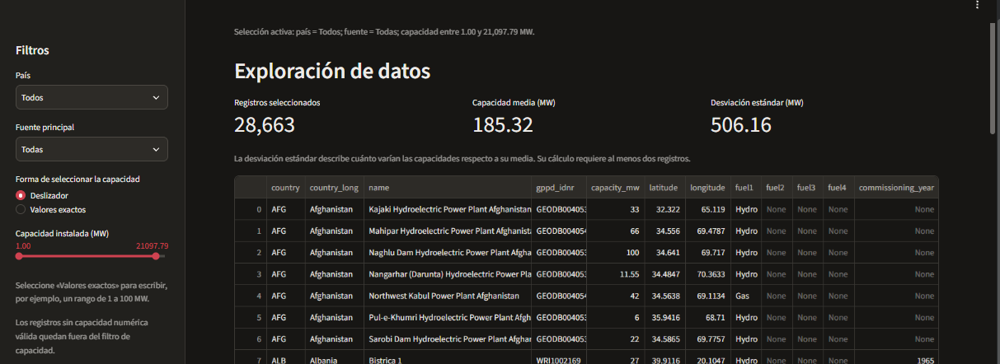

# Panorama de centrales eléctricas

Dashboard interactivo desarrollado con Python y Streamlit a partir
del análisis exploratorio de Global Power Plant Database realizado
en la Tarea 3. Permite explorar registros de centrales eléctricas
mediante filtros por país, fuente principal de energía y capacidad
instalada, con métricas, gráficos y una vista geográfica.

El archivo analizado contiene 28,664 registros. La fuente original
es Global Power Plant Database, del World Resources Institute:
https://github.com/wri/global-power-plant-database.
Se eligió este conjunto por sus variables de capacidad, generación
y ubicación, útiles para comparar características de las centrales.

La aplicación comunica los hallazgos a una audiencia no técnica.
Las métricas y visualizaciones responden a los filtros; la prueba
estadística y la narrativa conservan los resultados originales del
EDA y están identificadas como tales.

## Aplicación publicada

Pendiente: agregar aquí el enlace público de Streamlit Community Cloud.

## Captura del dashboard

## Funcionalidades

- Filtros por país y fuente principal de energía.
- Selección de capacidad mediante deslizador o valores exactos.
- Tabla de registros filtrados.
- Conteo, capacidad media y desviación estándar.
- Gráfico de barras, diagrama de caja y gráfico de dispersión.
- Mapa con validación del rango de las coordenadas.
- Resultado original de la prueba t de Welch.
- Narrativa de hallazgos y limitaciones.

## Principales hallazgos del EDA

1. Hydro fue la fuente más frecuente, con 7,034 registros, seguida
   de Solar con 5,424 y Wind con 5,084.
2. La capacidad instalada presentó una media de 186.10 MW y una
   desviación estándar de 523.03 MW, indicando una amplia dispersión.
3. La capacidad y la generación estimada mostraron una correlación
   positiva de 0.909 en 27,536 registros completos. Esta asociación
   no demuestra causalidad.
4. La capacidad media fue de 10.628 MW para Solar y 45.791 MW para
   Wind. La prueba de Welch obtuvo t = -23.5534 y
   p = 3.724047e-117. La diferencia no demuestra mayor eficiencia.
5. En los mismos 383 registros disponibles entre 2013 y 2015,
   la generación media aumentó aproximadamente 9.76 %.
   Este resultado no representa una tendencia global.

## Instalación y ejecución local

Se requiere Python y descargar los archivos del repositorio.

Desde una terminal, ubicada en la carpeta del proyecto:

    python -m pip install -r requirements.txt
    python -m streamlit run app.py

El archivo global_power_plant_database.csv debe permanecer
en la misma carpeta que app.py.

## Archivos del proyecto

- app.py: código de la aplicación.
- requirements.txt: dependencias.
- global_power_plant_database.csv: datos utilizados.
- captura_dashboard.png: captura real de la aplicación.
- README.md: documentación del proyecto.

## Limitaciones

- Los datos corresponden al archivo utilizado en la Tarea 3;
  no constituyen información en tiempo real.
- Existen valores faltantes y coordenadas fuera de rango.
- Validar el rango de las coordenadas no garantiza su exactitud.
- La generación estimada no equivale a generación observada.
- Las comparaciones describen los registros disponibles y no
  necesariamente representan todo el sistema eléctrico mundial.
- La prueba estadística original no se recalcula con los filtros.

## Uso de inteligencia artificial

Se utilizó IA como apoyo en la elaboración y revisión del código,
la resolución de problemas de ejecución y la redacción de
explicaciones. El estudiante realizó pruebas de filtros y contrastó
las métricas mostradas con los resultados del EDA. Los prompts,
las respuestas y los ajustes se documentan en el notebook.

## Información académica

- Estudiante: Joel Meneses — completar nombre si corresponde.
- Curso: completar nombre oficial del curso.
- Grupo: completar.
- Universidad: Universidad Nacional Abierta y a Distancia — UNAD.
- Actividad: Tarea 4 — Comunicación de resultados mediante dashboard interactivo.
- Fecha de entrega: completar.
